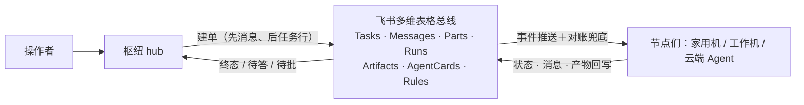

# lark-a2a-hub —— 多 Agent 中台（飞书多维表格总线）

一套已经在生产运行的多 Agent 协作系统：**用飞书多维表格当消息总线与
状态层**，数据模型借 A2A 协议；一个枢纽（hub）负责拆解、派发、审批与
结果呈递；任意终端装上节点适配器即可入列干活，云端 Agent 也能按协议
直接接入。任务只有一个发起面和一个状态面，全程留痕可查。

> 方向说明（标准 v3.1）：枢纽（hub）是逻辑角色而不是独立进程，由
> `hub-node daemon --role node|hub` 承载（省略 `--role` 时读 `node.json`
> 的 `role`，缺省 node）。一台机器要同时当 hub 与 node，起两个守护进程、
> 各用一个配置目录。仓库只有这一份 Node 实现。唤醒方式为 ws / poll /
> webhook 三种（webhook 专指飞书自动化出站通知，本项目任何进程不主动推送），
> 本项目任何进程都不开监听端口。hub 角色强制 ws。

本仓库包含系统的全部公开部分：

| 组成 | 位置 | 说明 |
|---|---|---|
| 中台标准 v3.1 | [docs/standard.md](docs/standard.md) | 七表对象模型、A2A 八态状态机、通信/审批/幂等协议（规范性文件） |
| 系统架构 | [docs/architecture.md](docs/architecture.md) | 分层、核心决策与理由、生命周期、故障模型 |
| Base 结构 | [docs/base-schema.md](docs/base-schema.md) · [schema/](schema/) | 七表字段级定义，由运行中的 Base 生成（附生成器） |
| 枢纽对接 | [docs/hub-integration.md](docs/hub-integration.md) · `src/hub/` | 枢纽职责、建单纪律、呈递与审批回路；实现是 `hub-node daemon --role hub` |
| 节点适配器 | 本仓库 `bin/` `src/` · [DESIGN.md](DESIGN.md) | 把任何终端变成执行节点：认领 → 拉起本机脚本/Agent → 收回执 → 落日志 |
| 协议接入 | [docs/protocol-node-runbook.md](docs/protocol-node-runbook.md) | 无守护进程的 Agent 按手册盯表接入（同一套协议） |



## 快速上手

### 路径 A：加入现成中台（装一个 node）

向中台管理员获取已建好的 Base 链接，只需 3 步：

1. **安装程序**（前置需 Node.js >= 20）：
   ```bash
   curl -fsSL https://raw.githubusercontent.com/backtomyfuture/lark-a2a-hub/main/install.sh | sh
   ```
   程序安装到 `~/.hub-node/app`，可执行入口链接至 `~/.local/bin/hub-node`。

2. **一键向导配置**：
   ```bash
   hub-node setup
   ```
   提示式向导会自动发现 lark-cli 应用、解析 Base 六表 ID、写入 600 权限的 `app.env` 与 `node.json`，种下初始回声能力并运行 `doctor` 自检。最后可直接确认注册开机自启。

3. **验收运行**：
   ```bash
   hub-node doctor      # 检查连通性与能力登记
   hub-node daemon      # 前台运行试跑（若 setup 中已注册自启则已常驻）
   ```
   由中台派发一条 `echo-test` 任务到该节点即可验证回显。

---

### 路径 B：自建中台（单机起 hub + node 双角色）

一台机器同时承担枢纽（发审批/呈递）与执行节点，起两个守护进程、各用一个配置目录与服务：

1. **准备 Base**：
   按照 [docs/base-schema.md](docs/base-schema.md) 在飞书多维表格中建好七张标准表，获取 Base 链接与机主的 `open_id`。安装程序：
   ```bash
   curl -fsSL https://raw.githubusercontent.com/backtomyfuture/lark-a2a-hub/main/install.sh | sh
   ```

2. **配置并启动枢纽（hub）**：
   ```bash
   hub-node setup --role hub --config ~/.hub-node-hub --owner <机主open_id>
   hub-node service --role hub --config ~/.hub-node-hub
   ```
   hub 强制长连接（ws），向导会尝试向 Base 注册云文档事件订阅；服务名为 `hub-node-hub.hub`。

3. **配置并启动执行节点（node）**：
   ```bash
   hub-node setup --role node --config ~/.hub-node
   hub-node service --role node --config ~/.hub-node
   ```
   node 服务名为 `hub-node-node.<节点名>`。两套守护进程独立运行、互不覆盖，各自记录日志。

---

### 接入外部 bot（如 Grok bot）：飞书自动化 + webhook

对于托管在外部云平台、无法运行 Node 守护进程且无长连接能力的 Agent（如 Grok bot）：

1. **定义与名片**：在 AgentCards 表登记该 bot 的能力与节点标识，`Receive_Mode` 设为 `automation`。
2. **飞书多维表格自动化**：在 Base 配置自动化流程——当 Tasks 表有新记录写入或状态变更（且 `Target_Node` 为该 bot）时，触发飞书自动化向该 bot 的公网端点发送 HTTP POST。**只发送 ID（Task_ID、状态、Msg_ID），不带任务正文与敏感数据**。
3. **拉取与回写**：外部 bot 收到 webhook 门铃后，通过飞书 REST API 回查 Messages / Parts 拉取参数；执行完毕后按 A2A 协议写回 Messages、Parts、Runs 并更新 Tasks 状态。外部 bot 须自行设置低频对账（如 15 分钟）兜底扫表。
> **红线原则**：本项目守护进程绝不开监听端口、不做端口映射与反向隧道，也不主动向外部节点发起推送（标准 §0 第 3 条、§10.3）。出站通知完全由飞书官方多维表格自动化驱动。详细规范见 [协议节点运行手册](docs/protocol-node-runbook.md)。

## 节点配置要点

- `node.json`：节点身份（node/zone）、总线参数（baseToken/tables）、凭据来源
  （appEnv 指向本地 env 文件，或 appId/appSecret 直填）、轮询与对账周期。
- `commands.json`：能力表。键是 Skill_ID，值是命令模板：
  - `mode: "json"` —— 脚本类：stdin 收任务信封，stdout 最后一行输出结果 JSON；
  - `mode: "agent"` —— Agent 类：模板含 `{prompt}`，输出纯文本＋结构化回执块。
  - 加能力、改能力或删能力只改这个文件。守护进程每轮用文件 mtime 与内容
    哈希判断它变没变；变了就串行对账 AgentCards：新增或修改的能力更新名片，
    从文件里删掉的能力把名片 `Dispatchable` 置为 `No`。进程启动后的第一次同步，
    以及 carrier 在线状态变化时，也会强制校准名片。`registeredCards` 和
    `carrierAvailability` 只在这一轮写表全部成功之后才更新；写到一半失败就保持
    上一版缓存，下一轮再补，不会把“没写上”当成“已经同步”。
  - `commands.json` 临时解析失败时保留上一版有效能力表，并暂停派发新任务
    （任务留在 `submitted`，不会因为能力表被清空而拒成终态 `rejected`）。
    文件修好后，下一轮检测到变更会自行恢复派发。
- 能力分三层：确定性脚本、指定本地 Agent 执行指定 Skill、通用能力
  （Agent＋工具面）——都是命令模板，守护进程是薄壳，不内嵌执行器。
- 凭据只存节点本地，绝不进总线；节点只发起出站连接，不开监听端口。

### carrier：需要局域网的能力（macOS）

macOS 上由 launchd 拉起的守护进程访问局域网会被系统本地网络隐私机制拦截
（见 DESIGN.md §9）。需要局域网的能力，在 `commands.json` 的条目里加
`"context": "carrier"`，再在你日常的终端（比如常开的 Ghostty/tmux 里）跑：

```bash
hub-node host     # 前台常驻，保持终端开启；Ctrl-C 退出
```

守护进程会经本地 unix socket 把这类命令交给 carrier 在终端语境里代跑；
carrier 不在线时，这些能力在名片上自动标离线、任务明确拒收，绝不静默
改走直跑。在线状态相对上次成功写表发生变化时，会再强制校准一次名片，
并且仍是写表成功之后才记住新的 `carrierAvailability`。`hub-node doctor`
默认只报告 carrier socket 是否在线。

[DESIGN.md](DESIGN.md) §9 注记④ 的限定：carrier 必须由用户在拥有局域网路由
和本地网络权限的交互终端里启动（守护进程只连接、从不拉起它）。socket
在线只说明本机 carrier 在听，不代表远端局域网目标一定可达。要实测该目标：

```bash
hub-node doctor --probe <host:port>   # 经在线 carrier 做一次只读 TCP 探测
```

## 版本与变更

见 [CHANGELOG.md](CHANGELOG.md)。参与改进见
[CONTRIBUTING.md](CONTRIBUTING.md)。

License: MIT
