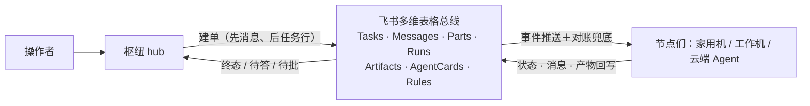

# lark-a2a-hub —— 多 Agent 中台（飞书多维表格总线）

一套已经在生产运行的多 Agent 协作系统：**用飞书多维表格当消息总线与
状态层**，数据模型借 A2A 协议；一个枢纽（hub）负责拆解、派发、审批与
结果呈递；任意终端装上节点适配器即可入列干活，云端 Agent 也能按协议
直接接入。任务只有一个发起面和一个状态面，全程留痕可查。

本仓库包含系统的全部公开部分：

| 组成 | 位置 | 说明 |
|---|---|---|
| 中台标准 v3.0 | [docs/standard.md](docs/standard.md) | 七表对象模型、A2A 八态状态机、通信/审批/幂等协议（规范性文件） |
| 系统架构 | [docs/architecture.md](docs/architecture.md) | 分层、核心决策与理由、生命周期、故障模型 |
| Base 结构 | [docs/base-schema.md](docs/base-schema.md) · [schema/](schema/) | 七表字段级定义，由运行中的 Base 生成（附生成器） |
| 枢纽对接 | [docs/hub-integration.md](docs/hub-integration.md) · [hub/](hub/) | 枢纽职责、建单纪律、呈递与审批回路＋一份可运行的参考实现 |
| 节点适配器 | 本仓库 `bin/` `src/` · [DESIGN.md](DESIGN.md) | 把任何终端变成执行节点：认领 → 拉起本机脚本/Agent → 收回执 → 落日志 |
| 协议接入 | [docs/protocol-node-runbook.md](docs/protocol-node-runbook.md) | 无守护进程的 Agent 按手册盯表接入（同一套协议） |



## 作为节点加入一个现成的中台

```bash
curl -fsSL https://raw.githubusercontent.com/backtomyfuture/lark-a2a-hub/main/install.sh | sh
hub-node setup      # 纯提示式向导，见下
```

脚本把程序装到 `~/.hub-node/app`、配置放在 `~/.hub-node/`、命令入口链接到
`~/.local/bin/hub-node`；重跑即更新，已有配置不覆盖。前置只有 Node >= 20
与一张按标准建好的 Base（向中台的操作者要链接即可）。

setup 是纯提示式：粘贴 Base 链接、给节点起个名、选一下机器在哪
（家里/公司），最后确认一眼即可；用哪个应用在只有一个时自动选定。
lark-cli 没装它会装、已配的应用它会复用（Secret 只在本机从配置/钥匙串
解析进 app.env，权限 600，绝不进总线）；表 ID 自动发现，app.env /
node.json / commands.json 全部自动生成，最后跑一遍 doctor 自检并可顺带
注册自启。全参数化也可以：
`hub-node setup --base <Base链接> --node <节点名> --yes --service`。

```bash
hub-node doctor     # 之后随时复检
hub-node daemon     # 前台试跑（setup 里选了自启则已在跑）
hub-node service    # 注册/卸载开机自启（macOS launchd / Linux systemd 用户级）
```

手动安装等价于 clone 本仓库后 `npm install`，再把示例配置拷到配置目录。

## 搭一个自己的中台

1. 照 [docs/base-schema.md](docs/base-schema.md) 在飞书多维表格里建七张表
   （或用字段 API 批量建），得到 Base token；
2. 按 [hub/README.md](hub/README.md) 部署枢纽参考实现（接收端常驻＋
   watcher 周期跑），并在本机交互终端完成一次事件订阅注册；
3. 每台机器按上一节入列；没有守护进程的 Agent 按
   [协议节点运行手册](docs/protocol-node-runbook.md) 接入。

## 节点配置要点

- `node.json`：节点身份（node/zone）、总线参数（baseToken/tables）、凭据来源
  （appEnv 指向本地 env 文件，或 appId/appSecret 直填）、轮询与对账周期。
- `commands.json`：能力表。键是 Skill_ID，值是命令模板：
  - `mode: "json"` —— 脚本类：stdin 收任务信封，stdout 最后一行输出结果 JSON；
  - `mode: "agent"` —— Agent 类：模板含 `{prompt}`，输出纯文本＋结构化回执块。
  - 加能力、改能力或删能力只改这个文件。守护进程每轮用文件 mtime 与内容
    哈希判断它变没变；变了就串行对账 AgentCards：新增或修改的能力更新名片，
    从文件里删掉的能力把名片 `Dispatchable` 置为 `No`。进程启动后的第一次同步，
    以及 carrier 在线状态变化时，也会强制校准名片。`registeredCards` 和
    `carrierAvailability` 只在这一轮写表全部成功之后才更新；写到一半失败就保持
    上一版缓存，下一轮再补，不会把“没写上”当成“已经同步”。
  - `commands.json` 临时解析失败时保留上一版有效能力表，并暂停派发新任务
    （任务留在 `submitted`，不会因为能力表被清空而拒成终态 `rejected`）。
    文件修好后，下一轮检测到变更会自行恢复派发。
- 能力分三层：确定性脚本、指定本地 Agent 执行指定 Skill、通用能力
  （Agent＋工具面）——都是命令模板，守护进程是薄壳，不内嵌执行器。
- 凭据只存节点本地，绝不进总线；节点只发起出站连接，不开监听端口。

### carrier：需要局域网的能力（macOS）

macOS 上由 launchd 拉起的守护进程访问局域网会被系统本地网络隐私机制拦截
（见 DESIGN.md §9）。需要局域网的能力，在 `commands.json` 的条目里加
`"context": "carrier"`，再在你日常的终端（比如常开的 Ghostty/tmux 里）跑：

```bash
hub-node host     # 前台常驻，保持终端开启；Ctrl-C 退出
```

守护进程会经本地 unix socket 把这类命令交给 carrier 在终端语境里代跑；
carrier 不在线时，这些能力在名片上自动标离线、任务明确拒收，绝不静默
改走直跑。在线状态相对上次成功写表发生变化时，会再强制校准一次名片，
并且仍是写表成功之后才记住新的 `carrierAvailability`。`hub-node doctor`
默认只报告 carrier socket 是否在线。

[DESIGN.md](DESIGN.md) §9 注记④ 的限定：carrier 必须由用户在拥有局域网路由
和本地网络权限的交互终端里启动（守护进程只连接、从不拉起它）。socket
在线只说明本机 carrier 在听，不代表远端局域网目标一定可达。要实测该目标：

```bash
hub-node doctor --probe <host:port>   # 经在线 carrier 做一次只读 TCP 探测
```

## 版本与变更

见 [CHANGELOG.md](CHANGELOG.md)。参与改进见
[CONTRIBUTING.md](CONTRIBUTING.md)。

License: MIT
